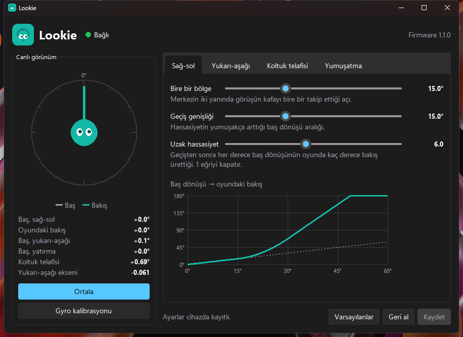

# LookieDesktop

The Windows app for the [Lookie](https://github.com/hasanberkm/LookieFirmware) head
tracker. It connects to the device over Bluetooth, shows the live view, changes
the settings while the device runs, keeps up to 3 settings profiles (optionally
password protected) and installs app and firmware updates.

[Türkçe](README.tr.md)



## Running

```bash
python -m pip install -r requirements.txt
```

```bash
python lookie_app.py
```

## Building the exe

```bash
build.bat
```

The result is `dist\Lookie.exe`.

## Publishing an update

The app reads the latest release of this repository
(`releases/latest`) and offers newer app and firmware versions.

1. Raise `APP_VERSION` in `lookie_app.py` and add the version's notes to the top of
   `changelog.py` (they are shown in the app after the update). Build the exe, and compile the firmware in the LookieFirmware
   repository. Use `LookieFirmware.ino.bin` from the build folder, not the merged
   file.
2. Create the release files:

   ```bash
   python tools/make_update_json.py --app dist/Lookie.exe --app-version 1.1.0 --fw <build folder>/LookieFirmware.ino.bin --fw-version 1.2.1
   ```

3. Create a GitHub release (for example tag `v1.2.1`) and attach every file from
   `release/`. The release must not be a draft or a pre-release, and the
   repository must be public.

Give only `--app` or only `--fw` when only one of them changed.

## Tools

| File | Contents |
|---|---|
| [`tools/make_update_json.py`](tools/make_update_json.py) | Creates the release files (see above). |
| [`tools/ets2-headtracking.ps1`](tools/ets2-headtracking.ps1) | Binds Lookie to the TrackIR input of ETS2/ATS so that the camera follows the head one to one. See the Lookie README. |
| [`tools/joy-calibration-backup.reg`](tools/joy-calibration-backup.reg) | A backup of the author's earlier Windows axis calibration entry, kept for reference. |

## License

GNU General Public License v3.0, see [LICENSE](LICENSE).
