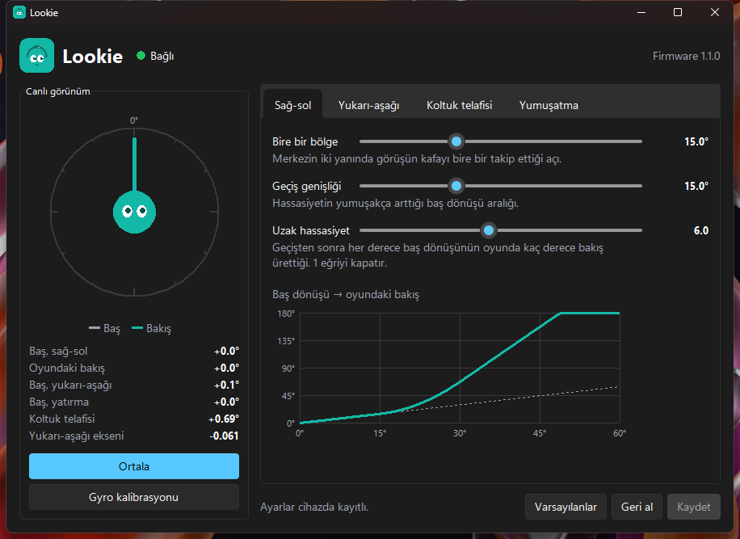

# LookieDesktop

[Lookie](https://github.com/hasanberkm/LookieFirmware) kafa takip cihazının Windows
uygulaması. Cihaza Bluetooth ile bağlanır, canlı görünümü gösterir, ayarları
cihaz çalışırken değiştirir, en fazla 3 ayar profili tutar (istenirse şifreli)
ve uygulama ile firmware güncellemelerini yükler.

[English](README.md)



## Çalıştırma

```bash
python -m pip install -r requirements.txt
```

```bash
python lookie_app.py
```

## Exe oluşturma

```bash
build.bat
```

Sonuç `dist\Lookie.exe` dosyasıdır.

## Güncelleme yayınlama

Uygulama bu reponun son yayınını (`releases/latest`) okur ve daha yeni uygulama
ve firmware sürümlerini sunar.

1. Exe'yi oluşturun ve firmware'i LookieFirmware reposunda derleyin.
   Derleme klasöründeki `LookieFirmware.ino.bin` dosyasını kullanın, birleşik
   (merged) dosyayı değil.
2. Yayın dosyalarını hazırlayın:

   ```bash
   python tools/make_update_json.py --app dist/Lookie.exe --app-version 1.1.0 --fw <derleme klasörü>/LookieFirmware.ino.bin --fw-version 1.2.1
   ```

3. GitHub'da bir Release oluşturun (ör. etiket `v1.2.1`) ve `release/`
   içindeki bütün dosyaları ekleyin. Release taslak ya da ön sürüm olmamalı ve
   repo herkese açık olmalı.

Yalnızca biri değiştiyse yalnızca `--app` ya da yalnızca `--fw` verin.

## Araçlar

| Dosya | İçerik |
|---|---|
| [`tools/make_update_json.py`](tools/make_update_json.py) | Yayın dosyalarını hazırlar (yukarıya bakın). |
| [`tools/ets2-headtracking.ps1`](tools/ets2-headtracking.ps1) | Lookie'yi ETS2/ATS'nin TrackIR girişine bağlar; kamera kafayı bire bir takip eder. Ayrıntılar Lookie README'sinde. |
| [`tools/joy-calibration-backup.reg`](tools/joy-calibration-backup.reg) | Geliştiricinin önceki Windows eksen kalibrasyonu kaydının başvuru amaçlı yedeği. |

## Lisans

GNU General Public License v3.0, bkz. [LICENSE](LICENSE).
